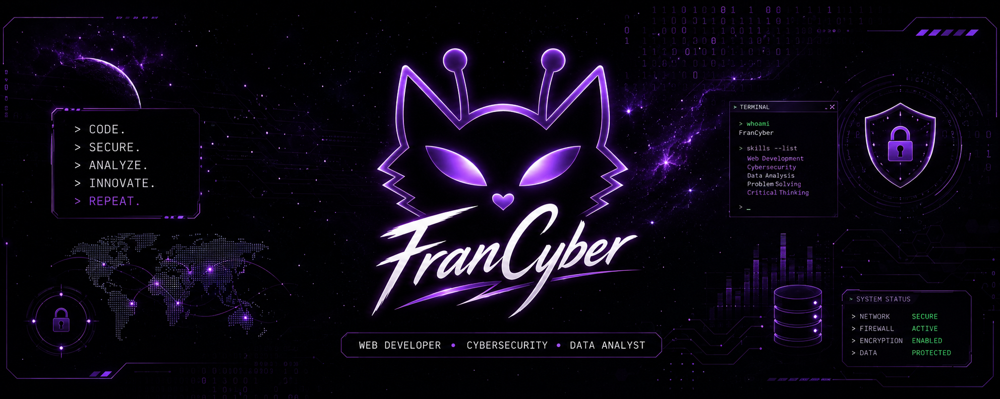

🔴🟡🟢

 

  

🛡️ Cybersecurity & Data Analysis Student | Understanding how systems are built to know how to protect them.Leveraging a solid background in Full-Stack Web Development to transition into network security and IT support. I combine analytical thinking with hands-on technical skills to solve problems, analyze traffic, and secure environments. 
💻 Tech Stack & Labs: Network analysis & simulation (Wireshark, Cisco Packet Tracer), Relational Databases (SQL Server), Version Control (Git/GitHub), Linux, and Web Technologies (HTML/CSS/JS). 
🌱 Continuous Growth: Currently preparing for the Cisco CCST Cybersecurity certification, diving into HIDS/Firewalls, and advancing my professional English (B1 target). 
⚡ Beyond the Terminal: INFJ. When I'm not configuring networks or querying databases, I'm probably dancing (proud K-Pop dance crew member!), video editing, or exploring digital creation. 
 
  

`Tech enthusiast | Lifelong learner | Digital architect.`
   

  `=========================`
   

(˵◝ ⩊ ◜˵マ

  ## 🛠️ &nbsp;Tech Stack & Tools

  &nbsp;
  &nbsp;
  &nbsp;
  &nbsp;
  &nbsp;
  &nbsp;
  &nbsp;
  &nbsp;
  
  &nbsp;
  &nbsp;

